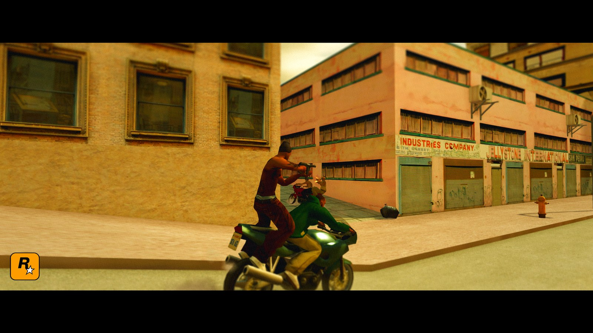
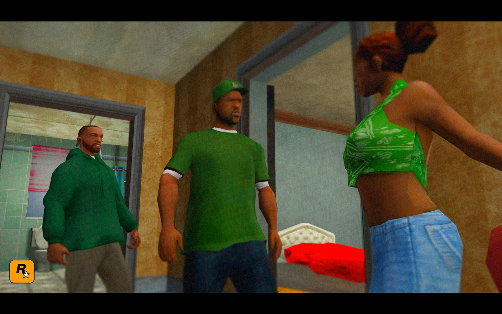
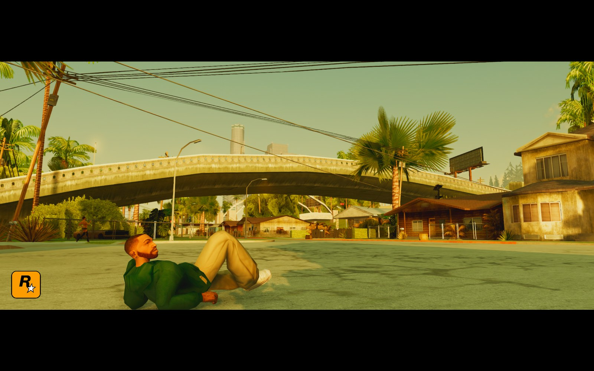
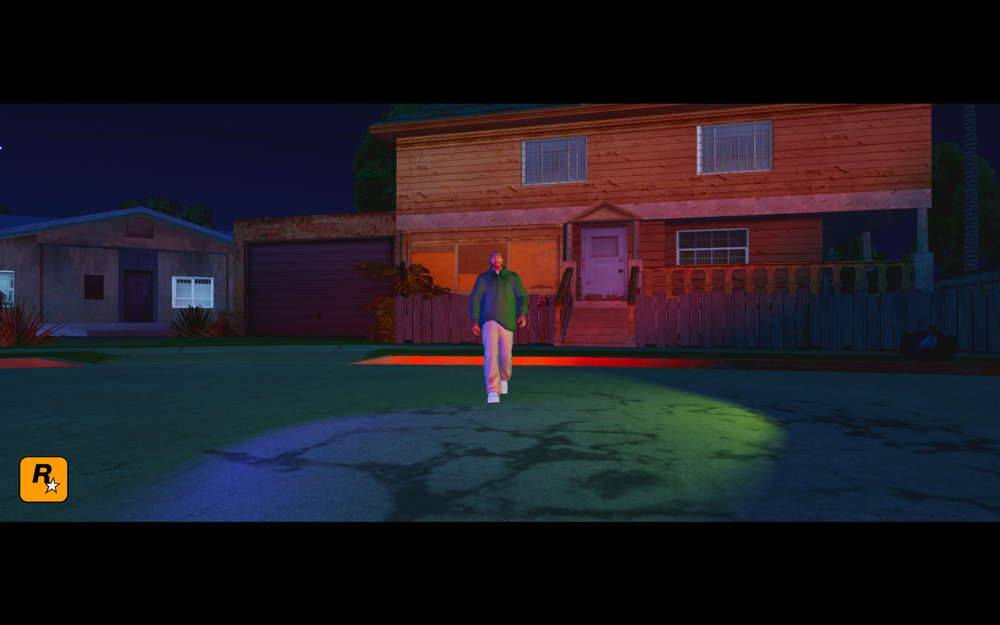
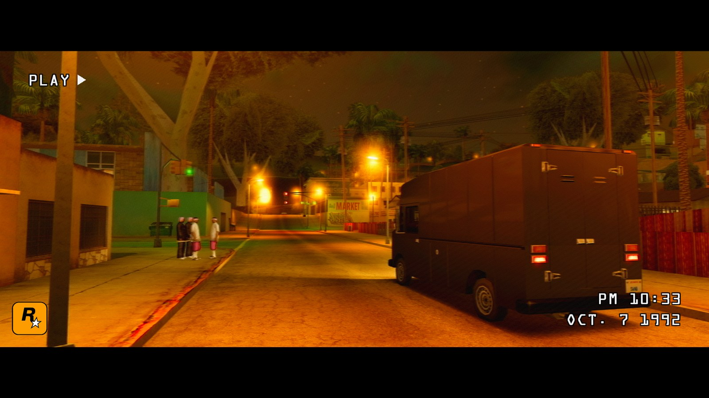
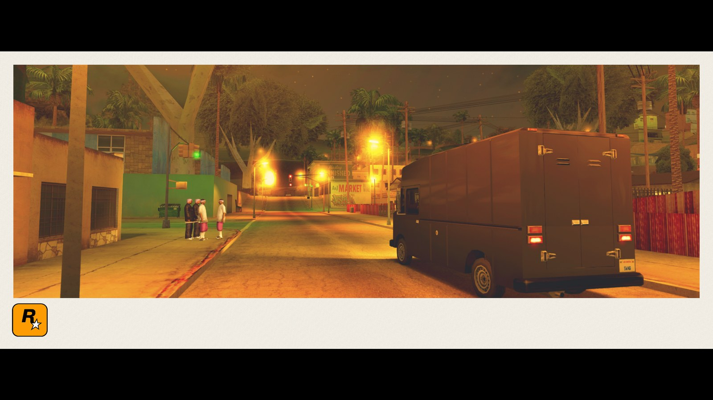
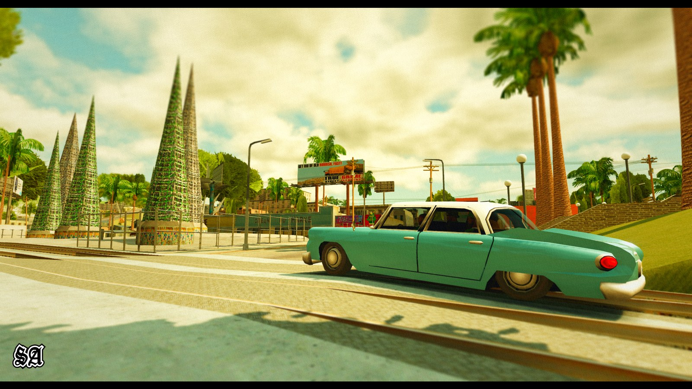
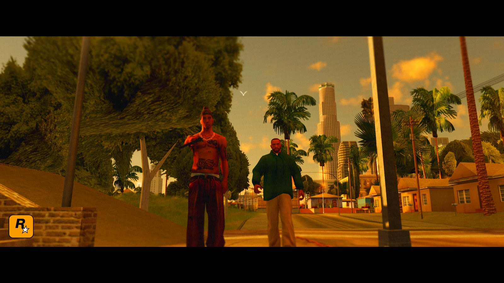
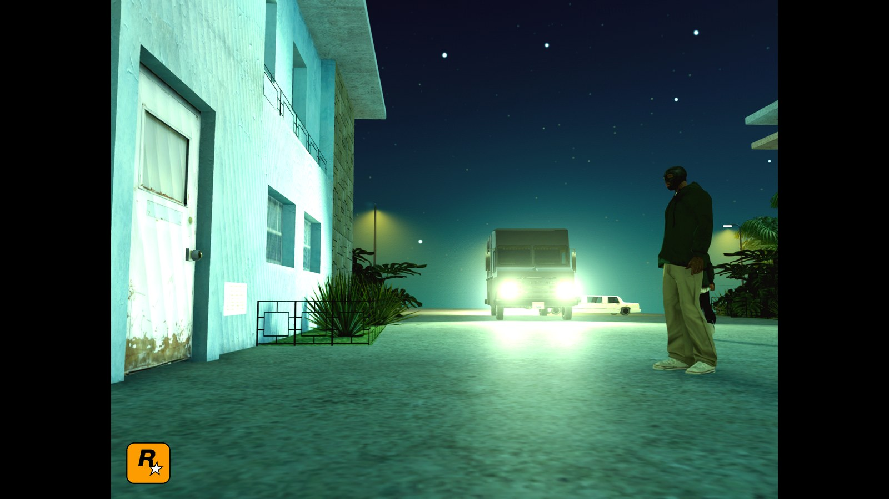

# Alek's Photo Mode SA

A photo mode for **GTA San Andreas (1.0 US)**, inspired by the photo modes of modern games. It freezes the game, gives you a free camera, hides the HUD and saves full-resolution PNG photos.

**[Download the latest release](../../releases/latest)**: get the zip under *Assets*, not the source code.



## Gallery

All shots taken in game with the mod. No editing.

| | | |
| --- | --- | --- |
|  |  |  |
| Cutscenes, frozen | CJ poses, resting on the ground | Movable red and blue lights |
|  |  |  |
| 90s camcorder filter | Polaroid filter | Frames and logos |
|  |  | |
| Time of day | Night | |

## Features

- **Free camera** with collision, roll and zoom, plus an **orbit camera** around CJ.
- **CJ poses** (39) with a pose-moment slider, including aiming and firing stances. Sitting, lying, knocked out and crouched poses rest on the ground. Add your own animations under `[CustomPoses]` in the INI.
- **Weapon in hand**: put any of 24 weapons in CJ's hand for the photo without touching his inventory.
- **Expressions** and **Look at camera** (his head follows the camera).
- **Hide CJ** or **hide people**.
- **Time of day and weather**: everything goes back to normal when you exit.
- **Slow motion** and **next frame**: step the world one frame at a time.
- **Cutscene support**: camera locked and time frozen, with a free camera in outdoor cutscenes.
- **Lights**: up to 3 point lights, spotlights or a camera flash. **Move light** moves and aims a light while the camera stays put (like Alan Wake 2's portrait spot), or orbits it around CJ. With Proper Shaders the mod draws the lights itself, with **shadows** and smooth shading. Without Proper they go through the game's own lights.
- **Photo FX**: filters (B&W, sepia, cold, warm, vintage, Polaroid, 90s camcorder), exposure, contrast, saturation, temperature, vignette, grain, tilt-shift, lens drops, chromatic aberration, bloom, lens distortion, radial blur and haze.
- **Composition**: grids, cinematic frames (2.39:1, 16:9, 4:5…), logo overlays and presets.
- **Photo viewer** inside the game. Live **SkyGfx** preset switching.
- Spanish and English UI. Gamepad (with GInput button icons) and keyboard/mouse.
- Your settings are saved in `Documents\GTA San Andreas User Files\Aleks Photo Mode.ini`, so mod managers cannot wipe them.

## Install

1. You need GTA San Andreas **1.0 US** and an ASI Loader or Modloader.
2. Download the zip from [Releases](../../releases/latest).
3. With Modloader, copy the `Aleks Photo Mode` folder into `modloader`. Otherwise, copy its contents into the game folder.

**Open it:** R1 + Down on a gamepad (changeable in SETTINGS), or F6 on keyboard. Full controls are in `LEEME - README.txt` inside the zip.

Photos go to `Pictures\GTA San Andreas Photo Mode`. If something breaks, open an issue and attach `Aleks.PhotoMode.SA.log` from the mod folder.

## Building

The mod is a single 32-bit DLL (`.asi`) with no dependencies beyond the Windows SDK. It is built with [llvm-mingw](https://github.com/mstorsjo/llvm-mingw) (i686):

```bat
build.bat
```

This produces `Aleks.PhotoMode.SA.asi` and runs the math tests (`test_core.exe`). The pixel shaders (photo FX, lights and shadows) are compiled at runtime through `d3dcompiler_47.dll`.

### How the lights work with Proper Shaders

Proper's deferred light pass kept showing photo lights in an old state while car headlights were in view, so the mod lights the finished frame itself:

- **Position**: each pixel's position comes from Proper's depth buffer (`PS_GetDepthBuffer`, an INTZ texture, reversed-Z aware) and the camera's near/far planes.
- **Normals**: smooth normals come from Proper's normals buffer (`PS_GetNormalsLayerBuffer`, octahedral, world space).
- **Shadows**: they are screen-space. A short ray is marched from every pixel toward each light against the depth buffer, then blurred with depth-aware weights.

Source layout:

| File | What it holds |
| --- | --- |
| `src/phase1.cpp` | Entry point, hooks (D3D9, RenderWare camera, HUD, CGame::Process), freeze and free camera, capture |
| `src/photo_phase2.inc` | Game-side features: poses, weapons, expressions, look-at, peds, lights, cutscenes, time and weather, the light/shadow and post-FX shaders |
| `src/photo_ui.inc` | The interface: menu, prompts, photo viewer, logos, light markers |
| `src/photo_menu.h` | Menu items, translations, pose and expression lists |
| `src/phase1_core.h` | Portable camera math (tested by `src/test_core.cpp`) |

Every game address is for GTA SA 1.0 US and was checked against [DK22Pac's plugin-sdk](https://github.com/DK22Pac/plugin-sdk) and the game binary. Before patching code, the mod checks the original bytes and leaves other mods' hooks alone.

## Credits & inspiration

- **Photo Mode IV – Complete Edition** for GTA IV by **ChunkLeChuck**: the original inspiration. Its menu layout, tabs and overall feel are what this mod set out to bring to San Andreas.
- The photo modes of **The Last of Us Part II** and **Alan Wake 2** inspired the CJ poses and expressions, look-at-camera, the orbit camera and the movable lights.
- **XTC**, for the CJ pose idea and the reference that got the pose library started.
- Developed with the help of **Claude** (Anthropic's AI) for the coding, reverse engineering and debugging. Design, testing and every in-game check were done by Alexgg1014.
- Thanks to the community for the feedback and bug reports: Georgian, Daviserys, XTC, XG417, adambrock and everyone in the server.
- [DK22Pac's plugin-sdk](https://github.com/DK22Pac/plugin-sdk) and the reverse-engineering community, for the documented addresses and structures.

## License

[MIT](LICENSE). You can use, modify and share it; keep the copyright notice and give credit.

GTA San Andreas is a trademark of Rockstar Games. This is a fan-made mod, not affiliated with Rockstar Games or Take-Two Interactive.
